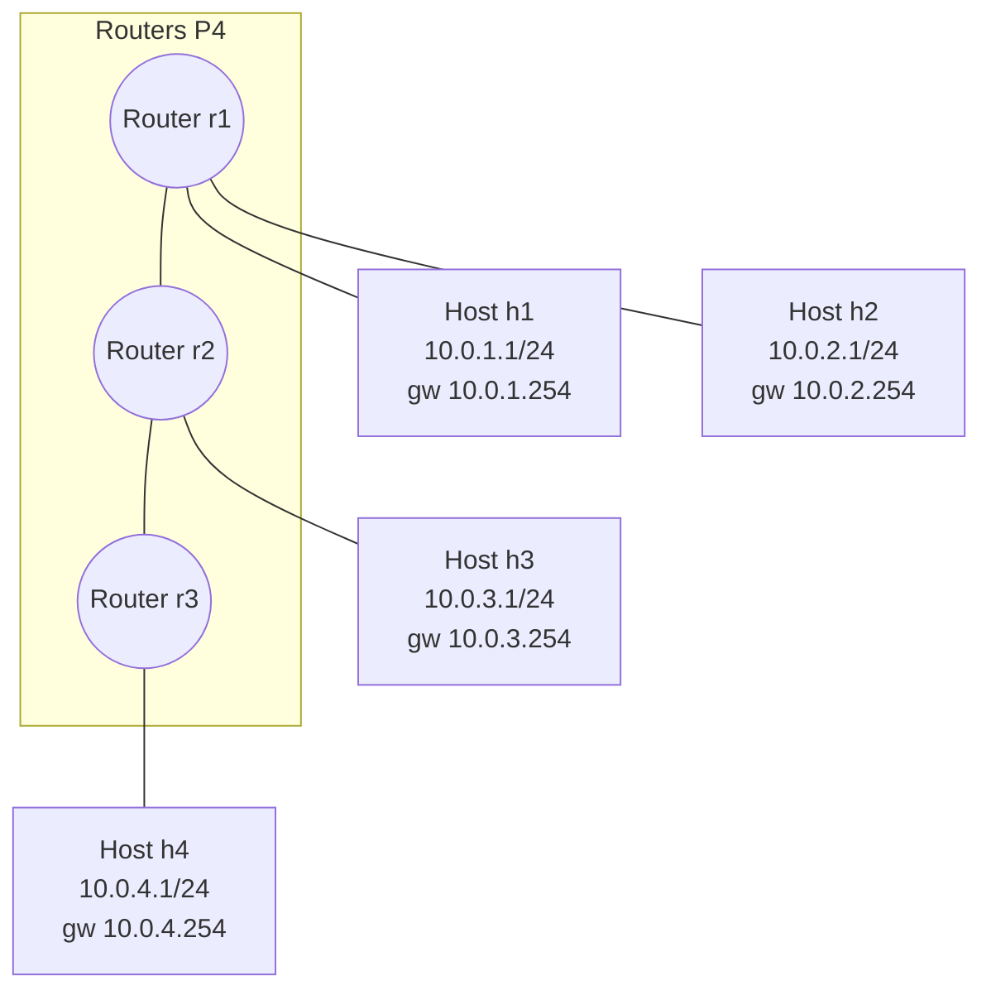

# Laboratorio 1: Router IPv4 Estático (`/lab1-router`)

Implementación en P4_16 (`v1model`) sobre BMv2 (`simple_switch`) y Mininet con 3 routers P4 (`r1`, `r2`, `r3`) y 4 hosts (`h1` a `h4`) en subredes distintas.

## Archivos

- `router.p4`: código del router. Parsea Ethernet e IPv4, consulta la tabla LPM `ipv4_lpm`, reescribe las MAC de origen y destino, decrementa el TTL y descarta paquetes sin ruta o cuyo TTL llegue a 0.
- `r1-commands.txt`, `r2-commands.txt`, `r3-commands.txt`: reglas estáticas que se cargan en cada router mediante `simple_switch_CLI`.
- `topology.py`: compila `router.p4`, levanta la topología en Mininet, aplica las reglas y configura ARP estático y rutas por defecto en los hosts.
- `verify_router.py`: pruebas con Scapy para verificar decremento de TTL por salto, descarte cuando TTL llega a 0 y descarte sin ruta.

## Topología



- `h1 -> h2`: cruza 1 router (`r1`).
- `h1 -> h3`: cruza 2 routers (`r1 -> r2`).
- `h1 -> h4`: cruza 3 routers (`r1 -> r2 -> r3`).

## Cómo ejecutarlo

Pruebas automáticas (`pingall` + `verify_router.py`):

```bash
cd lab1-router
sudo mn -c
sudo python3 topology.py --test
```

Modo interactivo con la consola de Mininet:

```bash
cd lab1-router
sudo mn -c
sudo python3 topology.py
```

Comandos útiles dentro de `mininet>`:

```text
mininet> pingall
mininet> h1 ping -c 1 10.0.2.1
mininet> h1 ping -c 1 10.0.3.1
mininet> h1 ping -c 1 10.0.4.1
mininet> h1 ping -c 1 -t 2 10.0.4.1
mininet> h1 ping -c 1 10.99.99.99
mininet> h1 python3 verify_router.py
```

Las capturas `.pcap` de cada interfaz se guardan en `pcaps/` y los logs de los routers en `logs/`.
