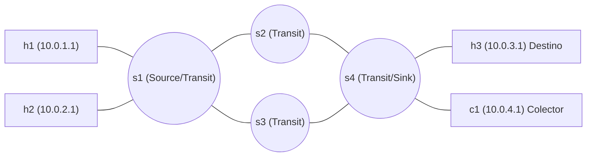

# Laboratorio 3: Telemetría In-Band (`/lab3-int`)

Implementación 3 (grupos de 3), a cargo de Hermes Josué Rojas Sancho.

Sistema simplificado de **In-Band Network Telemetry (INT)** inspirado en el modo **INT-MD** de la especificación P4.org v2.1, en P4_16 (`v1model`) sobre BMv2 (`simple_switch`) y Mininet.

## Topología

Cuatro switches P4 con dos caminos alternativos entre origen y destino, tres hosts generadores/receptores de tráfico y un host colector:



- **Camino inicial:** `s1 -> s2 -> s4`
- **Camino alternativo:** `s1 -> s3 -> s4`
- **Watchlist inicial en `s1`:** flujos `h1 (10.0.1.1) -> h3 (10.0.3.1)` en `UDP/5001` y `TCP/5001`. Otros flujos (como `h2 -> h3` o puertos distintos) se enrutan sin telemetría INT.

## Archivos

| Archivo | Descripción |
|---|---|
| `int.p4` | Programa P4 con cabeceras `int_ctrl` y pila `int_hops[8]`, señalización por `ipv4.diffserv = 0x5c`, parser de longitud variable, roles Source/Transit/Sink, límite `max_hops` con `overflow`, clonación I2E hacia el colector y recálculo de `totalLen` + checksum IPv4. |
| `s1-commands.txt` .. `s4-commands.txt` | Reglas estáticas de enrutamiento LPM, `switch_id`, `int_watchlist`, `int_sink_port` y `mirroring_add`. |
| `topology.py` | Compila `int.p4`, levanta la topología en Mininet, configura ARP estático y carga las reglas en los 4 switches. |
| `collector.py` | Colector en Python (Scapy) que decodifica reportes INT, imprime resumen por flujo cada 5 s, muestra alertas de congestión configurables y genera gráficas con `matplotlib` (opcional +10%). |
| `verify_int.py` | Pruebas automáticas de watchlist, paquete limpio en destino, `overflow`, congestión con `iperf` + `set_queue_rate`, cambio de ruta en caliente y gráfica `matplotlib`. |
| `demo_control.py` | Utilidad para cambiar la ruta (`s2`/`s3`) o limitar la cola de `s2` durante pruebas manuales. |

## Cómo ejecutarlo

### 1. Pruebas automáticas completas

```bash
cd lab3-int
sudo mn -c
sudo python3 topology.py --test
```

Al finalizar debe mostrar `TODAS LAS PRUEBAS PASARON` y guardar la gráfica de latencia y cola en `logs/telemetria.png`.

### 2. Modo interactivo (para demostración paso a paso)

Terminal 1 — levantar la red:
```bash
cd lab3-int
sudo mn -c
sudo python3 topology.py
```

Dentro de `mininet>`:
```text
mininet> c1 python3 collector.py --intervalo 5 --umbral-cola 3 --umbral-latencia 3000 &
mininet> h3 iperf -s -u -p 5001 > /dev/null 2>&1 &
mininet> h1 iperf -c 10.0.3.1 -u -p 5001 -b 1M -t 3
```

Terminal 2 — provocar congestión y cambiar ruta en vivo:
```bash
cd lab3-int
python3 demo_control.py --congestion 80
# (correr iperf desde h1 en Mininet y observar ALERTA CONGESTION en c1)
python3 demo_control.py --congestion 10000
python3 demo_control.py --ruta s3
# (correr tráfico desde h1 y observar ruta s1 -> s3 -> s4 en c1)
```
